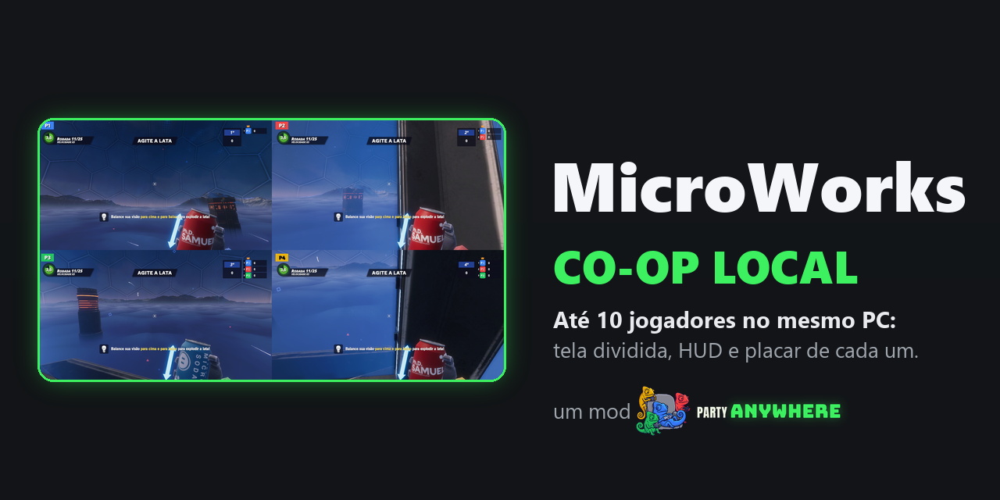

# MicroWorks Co-op Local

<p align="center"></p>

Até 10 pessoas no mesmo PC, no mesmo MicroWorks: cada uma com a sua parte da tela (ou o celular), o próprio
HUD, a própria arma, bola, sapo e kart, e os próprios pontos. Todo mundo é um jogador de verdade da partida,
como se tivesse entrado pela internet.

## Jogar

Precisa do **MicroWorks** (a sua cópia da Steam). O app acha sozinho ou deixa você escolher a pasta.

1. Instale o [Party Anywhere](https://github.com/joaocaioo/party-anywhere/releases/latest) (ele avisa quando há versão nova).
2. Na Biblioteca, em **Adicionar jogo → Por link**, cole `https://github.com/party-anywhere/microworks-coop`.
3. Conecte os controles ou escaneie o QR com o celular e aperte **Jogar**.

Com um agente de IA (Claude e outros), é só pedir *"instale este mod no Party Anywhere"* com o link deste repositório: o `AGENTS.md` diz a ele o que fazer (conferir o app, instalar se faltar e levar o mod para a sua Biblioteca).

### Controles

| Botão | Ação | Botão | Ação |
|---|---|---|---|
| Analógico esquerdo | Andar | Analógico direito | Olhar |
| A | Pular | B | Agachar |
| X | Usar | Y | Reações |
| RT | Atirar | LT | Tiro 2 |
| LB | Correr | RB | Empurrar |
| Clicar o esquerdo | Extra | Clicar o direito | Frente |
| Direcional | Votar / responder | Back | Jogadores |
| Start | Pausa | | |

## Como este mod funciona

- **Uma cópia do jogo**, com todos os jogadores dentro dela e uma visão por jogador (`pa docs coop`).
- Carregado pelo **BepInEx 5** (vai no pacote; LGPL-2.1). Nenhum arquivo original do jogo é trocado.
- **Um jogo só.** Quem hospeda cria a partida e cada pessoa do lobby do Party Anywhere entra nela como um
  jogador de verdade: aparece no placar, joga os microgames e troca de fase como num jogo online.
- **Tela dividida sem faixa preta:** os jogadores se dividem por igual entre as linhas e cada linha ocupa a
  largura toda (3 = 2+1, 5 = 3+2, 7 = 3+2+2, 10 = 4+3+3). Cada parte tem o HUD do seu jogador (rodada, placar,
  posição, "PASSOU/FALHOU"), e a tela se reorganiza quando alguém entra, sai ou passa a jogar pelo celular.
- **Quem é quem:** "P2" na cor da vaga no canto de cada parte e sobre a cabeça de cada jogador; cada boneco com
  a cor da vaga; no placar, "P1".."P10".
- **Desafios de responder** (a conta, digitar a palavra ou a cor, trivia, repetir a sequência, empilhar): cada um
  responde num painel na própria parte da tela (ou no celular), no direcional e no A. Quem joga no teclado usa o
  PDA do jogo, como sempre.
- **Celular:** com "Tela do jogo no celular" ligada, a parte daquela pessoa vai para o celular dela e sai da TV;
  arrastar o dedo na metade direita gira a câmera.
- **Vídeo:** com mais de um jogador na tela, o mod usa o preset mais leve do jogo só durante a partida; as suas
  configurações não mudam.
- **Sala:** sem o Party Pass do MicroWorks, a partida é uma sala pública (regra do jogo). O mod não contorna
  isso. Os jogadores chegam pelo SDK do Party Anywhere; o mod não lê o teclado nem os controles do Windows para
  quem está no lobby.

## Desenvolver

```powershell
powershell -File scripts\fetch-bepinex.ps1   # uma vez: BepInEx fixo na versão e no hash em vendor\
powershell -File scripts\dev-install.ps1     # compila e copia o mod para a pasta do jogo
```

Precisa do MicroWorks instalado (o build usa as DLLs dele, que não vão para o repositório) e do .NET SDK. Para
testar sem controles de verdade, com o Hub aberto: `pa phone-sim --players 4 --screen --save-view prints`.

- `powershell -File scripts\release.ps1` compila, confere e empacota em `release\`; `pa add .` leva para o seu Hub sem publicar.
- Com `-Publicar`, cria o release `vX.Y.Z` (igual ao `version` do `party-anywhere.json`) no GitHub. O build não roda no GitHub Actions porque precisa do jogo instalado.
